# 🌌 Awesome Astrology Computing & Cultural Heritage Software 🔭

**A definitive, SEO-optimized curated index of SaaS/hosted platforms, APIs, computational ephemeris engines, and open-source software libraries for Astrology Computing, Cultural Heritage Astronomy, and Historical Calendars.**

*Covering Swiss Ephemeris calculations, Western (Natal/Synastry/Transits), Vedic (Jyotish/Panchanga), Traditional Chinese (Zi Wei Dou Shu & BaZi), Hellenistic traditions, and Archaeoastronomy sky reconstructions.*

**Last updated: November 2026** 📅

---

## 📑 Table of Contents

- [🌌 Overview & Introduction](#-overview--introduction)
- [📊 Sector Overview & Market Dynamics](#-sector-overview--market-dynamics)
- [☁️ SaaS & Hosted Platforms](#️-saas--hosted-platforms)
- [💻 Open-Source GitHub Projects](#-open-source-github-projects)
- [📈 Star History](#-star-history)
- [🤝 How to Contribute](#-how-to-contribute)
- [💖 Support](#-support)
- [⚖️ Disclaimer](#️-disclaimer)

---

## 🌌 Overview & Introduction

Computational astrology and cultural astronomy software operate at the crossroads of precision mathematics, celestial mechanics (using NASA JPL DE431/DE440 ephemerides), historical calendrical science, and cultural heritage preservation.

This repository tracks the leading **commercial SaaS / hosted platforms** and **developer-first open-source libraries** worldwide. Whether you are building an AI-powered astrology application, researching archeoastronomy, calculating high-precision planetary coordinates (Swiss Ephemeris), or preserving ancient lunisolar calendars (Chinese Huangli, Hindu Panchanga, Hebrew, Islamic, or Mayan systems), this guide provides benchmark references, code repositories, and pricing transparency.

---

## 📊 Sector Overview & Market Dynamics

The global astrology application and software ecosystem is estimated between **$1.2 billion and $6.5 billion** (depending on whether broader human consultation marketplaces and digital wellness subscriptions are included) and is compounding at an estimated **19% to 25% CAGR** driven by mobile adoption, generational wellness interest, and API-driven real-time ephemeris integrations.

The sector is **moderately to highly fragmented** rather than a winner-take-all monopoly:
- **Diverse Paradigms & Cultural Traditions:** Western psychological astrology, Indian Vedic (Jyotish) systems, and Chinese metaphysics (Zi Wei Dou Shu / BaZi) require deeply distinct mathematical engines, chart-wheel projections, and regional language localizations, fostering strong regional champions rather than a single global player.
- **Low Software Barriers vs. High Specialized Knowledge:** Creating a basic birth chart frontend is straightforward, but crafting high-precision calculation engines, planetary aspect algorithms, and specialized interpretation rulebases keeps the market divided across hundreds of specialized desktop suites, mobile apps, and independent API providers. Even the combined market share of the top 5 commercial mobile apps accounts for under 30% of global sector revenues.

---

## ☁️ SaaS & Hosted Platforms

> [!NOTE]
> All SaaS products are ranked in **descending order by company valuation / estimated size**. Clear starting tier prices and explicit free-tier limits or trial windows are specified below.

| Platform | Category / Focus | Company Size (Valuation / Revenue) | Starting Pricing (Specific Tier) | Free Tier Limits / Free Trial Plan |
| :--- | :--- | :--- | :--- | :--- |
| **[Co-Star](https://costarastrology.com)** | Mobile AI & JPL Ephemeris Astrological Social Platform | **$30M+ Est. Valuation** (Raised $21M total funding; Acquired by Midjourney in 2026; ~4.3M MAU) | **$8.99/month** (*Pro-Star* auto-renewing subscription tier) | **Free Forever Plan**: Generates 1 personal natal chart, daily basic horoscopes, and basic friend chart compatibility; in-app deep-dive readings are locked behind one-off purchases or Pro-Star |
| **[The Pattern](https://thepattern.com)** | Psychological Timing, Transits & Relationship Compatibility | **$20M+ Est. Valuation** (Raised ~$7M+ Seed/Venture rounds; ~$3M–$5M ARR; 15M+ registered users) | **$14.99/quarter** (~$4.99/mo equivalent for "Go Deeper" membership) | **Free Forever Plan**: Access personal astrological profile, current personal cycle timings, and basic friend/bond compatibility; detailed multi-year cycle breakdowns and deep relationship bonds require subscription |
| **[Sanctuary](https://sanctuaryworld.co)** | Interactive Divination, Daily Horoscopes & Mystic Marketplace | **$12M–$15M Est. Valuation** (Raised $6.5M–$10.3M across Seed rounds; ~$3.3M ARR) | **$4.99/month** (Sanctuary Pro / Extended Access tier) | **Free Forever Plan**: 1 basic birth chart calculation, daily sign horoscope text, and educational transit guides; 1-on-1 psychic/astrologer live text consultations charged per minute (~$19.99/15 min) |
| **[Astrodienst (Astro.com)](https://astro.com)** | High-Precision Swiss Ephemeris Web Portal & Chart Engine | **$5M–$10M Est. Valuation** (~$2M–$5M ARR, Bootstrapped Swiss Corporation founded 1980) | **$20.00/year** (Astro*Plus Daily Transit / Extended Personal Horoscope subscription; individual store reports from $15.00) | **Free Forever Plan**: Full access to the legendary *Extended Chart Selection* tool with Swiss Ephemeris calculations, dozens of house systems, and up to 100 stored birth chart profiles at zero cost |
| **[Solar Fire (Esoteric Technologies / Astrolabe)](https://alabe.com)** | Professional Desktop Suite & Cloud Astrological Workstation | **$3M–$7M Est. Valuation** (~$1M–$2.5M annual sales, Established industry authority) | **$360.00 one-time** (New full commercial desktop license; upgrade from previous version starts at $80.00) | **No Free Forever Plan**: 30-day feature-complete free trial available upon request via distributor download |
| **[Kepler & Sirius (Cosmic Patterns Software)](https://astrosoftware.com)** | Advanced Research, Vedic, Harmonic & Multilingual Charting Suite | **$2M–$5M Est. Valuation** (~$800k–$2M annual sales, Private specialized software house) | **$100.00 one-time** (*Pegasus* entry license; *Kepler 9.0* full license is $300.00 one-time; *Sirius 4.0* is $550.00 one-time) | **No Free Forever Plan**: 30-day evaluation trial demo package available upon request |
| **[TimePassages (AstroGraph Software)](https://astrograph.com)** | Desktop, Web & Mobile Astrology and Transit Forecasting | **$2M–$5M Est. Valuation** (~$1M–$3M ARR across mobile subscriptions and desktop licenses) | **$7.99/month** (*TimePassages Pro* mobile subscription; Desktop Basic Edition starts at $79.00 one-time) | **Free Forever Plan**: Free iOS/Android app with basic personal natal chart, Big Three breakdown, and daily planetary overview; advanced progression modules and extra charts require $0.99–$9.99 in-app purchases |
| **[Astro-Charts](https://astro-charts.com)** | Modern SVG Birth Chart Wheel Generator & Celebrity Database | **$1M–$3M Est. Valuation** (~$500k–$1.5M ARR, Bootstrapped SaaS) | **$15.00/month** (*Astro-Charts Pro* membership; one-time in-depth PDF reports start at $35.00) | **Free Forever Plan**: Generates free visual birth charts, basic aspect pattern breakdowns, and access to public celebrity chart directory; transit tracking and astrocartography require Pro |
| **[Cafe Astrology](https://cafeastrology.com)** | Educational Astrology Portal, Interpretations & Report Store | **$1M–$2M Est. Valuation** (~$300k–$800k ARR, Ad & Computerized Report model) | **$2.95 per report** (Store computerized reports start at $2.95; package bundles up to $16.00) | **Free Forever Plan**: 100% free web natal chart calculations, rising sign calculators, synastry overview tables, and public ephemeris archives with ad-supported web access |
| **[Astro-Seek](https://astro-seek.com)** | Comprehensive Online Ephemeris & Chart Calculation Portal | **$1M–$2M Est. Valuation** (~$300k–$700k ARR, Sustained via advertising & sponsorships) | **$0.00 (100% Free / Ad-Supported)** (Optional ad-free access granted via community advocacy/affiliate promotion) | **Free Forever Plan**: Completely unrestricted access to natal, transit, synastry, composite, Vedic, Hellenistic, Astrocartography, and astronomical ephemeris search engines with free user account to store unlimited charts |

---

## 💻 Open-Source GitHub Projects

> [!TIP]
> The table below showcases vetted, active open-source repositories for astronomical calculation, astrological charting, ephemeris engines, and cultural calendar software. 
> 
> **Sorted in descending order by GitHub_Stars ⭐**. Each Stars_Badge links directly to that repository's Stargazers page.

| Project / Library | Primary Focus & Capabilities | GitHub_Stars (Desc) | Primary Language / Stack |
| :--- | :--- | :---: | :--- |
| **[Renhuai123/ziwei-doushu](https://github.com/Renhuai123/ziwei-doushu)** | Open-source computational Purple Star Astrology (Zi Wei Dou Shu) chart calculation engine based on traditional Chinese metaphysics (*Tianji* / Ni Haixia tradition), with full star placements, four transformations (Si Hua), and ancient corpus datasets. |  | TypeScript / Python |
| **[Stellarium](https://github.com/Stellarium/stellarium)** | World-renowned open-source desktop planetarium and cultural astronomy simulation software rendering photorealistic skies in real-time, featuring 40+ historical sky cultures (Babylonian, Chinese, Hindu, Norse, Maya, Egyptian) and archaeoastronomical alignment tools. |  | C++ / OpenGL / Qt |
| **[astropy/astropy](https://github.com/astropy/astropy)** | Foundational core Python package for professional astronomy and astrophysics, providing celestial coordinates, high-precision time transformations, WCS projections, and celestial mechanics computation. |  | Python / C / Cython |
| **[AhmadHassan-BTed/SoulMatrix](https://github.com/AhmadHassan-BTed/SoulMatrix)** | Interactive Destiny Matrix (Soul Blueprint) live reading dashboard and script engine with real-time screen sync, couples compatibility analysis, and age timeline overlays. |  | TypeScript / React / Tailwind |
| **[SylarLong/iztro](https://github.com/SylarLong/iztro)** | High-performance, lightweight, zero-dependency JavaScript/TypeScript library for Zi Wei Dou Shu (Purple Star Astrology) and BaZi chart calculation, astrological star arrangements, and horoscopic personality evaluations. |  | TypeScript / JavaScript |
| **[FANzR-arch/Numerologist_skills](https://github.com/FANzR-arch/Numerologist_skills)** | Engineering framework and structured reasoning skills designed to stop LLM hallucinations in Chinese metaphysics (Qi Men Dun Jia, Zi Wei Dou Shu, and BaZi calculation procedures). |  | Python / PromptEng |
| **[unicode-org/icu4x](https://github.com/unicode-org/icu4x)** | High-performance Unicode cultural heritage calendar and internationalization components modularized in Rust, powering algorithmic conversions for Hebrew, Islamic, Chinese, Buddhist, Persian, and Coptic calendars. |  | Rust |
| **[skyfielders/python-skyfield](https://github.com/skyfielders/python-skyfield)** | Pure-Python high-precision astronomy calculation package computing planet, star, and moon ephemerides directly from NASA JPL DE405/DE421/DE440 series with barycentric dynamical time corrections. |  | Python |
| **[6tail/lunar-javascript](https://github.com/6tail/lunar-javascript)** | Comprehensive Chinese lunisolar calendar library supporting Gregorian/Solar to Lunar conversion, 24 Solar Terms, Eight Characters (BaZi), Almanac (Huangli) taboos, Taoist/Buddhist calendars, and 28 Lunar Mansions. |  | JavaScript |
| **[zampierilucas/scx_horoscope](https://github.com/zampierilucas/scx_horoscope)** | Unique Linux kernel sched_ext BPF scheduler implementing astrological calculation mechanics to govern CPU process time-slice priority based on celestial positions. |  | Rust / C (BPF) |
| **[dstndstn/astrometry.net](https://github.com/dstndstn/astrometry.net)** | Blind astrometric calibration service and software suite that recognizes star fields in images and outputs celestial coordinates, celestial orientation, and astrometric metadata. |  | C / Python |
| **[vedika-io/xalen-ephemeris](https://github.com/vedika-io/xalen-ephemeris)** | Pure-Rust astronomical ephemeris library purpose-built for multi-tradition astrology — supporting Vedic (Nirayana), Western (Tropical), Chinese, and 9 historical world traditions with zero C dependencies. |  | Rust |
| **[aloistr/swisseph](https://github.com/aloistr/swisseph)** | Official open-source C release of the Swiss Ephemeris by Astrodienst, the gold standard calculation engine for planetary coordinates, asteroids, house cusps, and eclipses based on NASA JPL ephemerides. |  | C / AGPL & Commercial |
| **[g-battaglia/kerykeion](https://github.com/g-battaglia/kerykeion)** | Modern data-driven Python astrology library wrapping Swiss Ephemeris to compute natal, synastry, and transit charts with native SVG visual chart generation and JSON data exports. |  | Python |
| **[6tail/lunar-python](https://github.com/6tail/lunar-python)** | Python implementation of the acclaimed `lunar` library for Solar and Chinese Lunisolar calendar computations, BaZi calculations, 24 Solar Terms, and traditional Chinese cultural timing. |  | Python |
| **[VedAstro/VedAstro](https://github.com/VedAstro/VedAstro)** | Non-profit, open-source multi-platform Vedic Astrology library and microservice API providing Panchanga calculations, Muhurtha timing, Dasha periods, and planetary strength analysis. |  | C# / .NET / Web |
| **[AstroDraw/AstroChart](https://github.com/AstroDraw/AstroChart)** | Free and open-source TypeScript / JavaScript library for generating crisp SVG radix and transit chart wheels in web browsers with customizable glyphs and aspect lines. |  | TypeScript / SVG |
| **[astrorigin/pyswisseph](https://github.com/astrorigin/pyswisseph)** | Official Python C-extension binding for the Swiss Ephemeris library, exposing high-precision planetary calculations, sidereal ayanamsas, and house systems to Python developers. |  | Python / C |
| **[flatangle/flatlib](https://github.com/flatangle/flatlib)** | Specialized Python library for Traditional and Hellenistic Astrology, computing planetary dignities, receptions, Arabic parts, aspect patterns, and primary directions. |  | Python |
| **[0xStarcat/CircularNatalHoroscopeJS](https://github.com/0xStarcat/CircularNatalHoroscopeJS)** | Pure ES6 JavaScript engine for calculating and rendering circular natal horoscope wheels, aspects, and house systems in modern web and mobile applications. |  | JavaScript |
| **[CruiserOne/Astrolog](https://github.com/CruiserOne/Astrolog)** | The legendary open-source astrology calculation and charting software created in 1991, featuring 3D celestial sphere renders, Gauquelin sectors, sidereal zodiacs, and command-line ephemerides. |  | C / C++ |
| **[mivion/swisseph](https://github.com/mivion/swisseph)** | High-speed Node.js C++ addon binding for Astrodienst Swiss Ephemeris, enabling backend Javascript/TypeScript web servers to compute charts on the fly. |  | C++ / JavaScript |
| **[naturalstupid/PyJHora](https://github.com/naturalstupid/PyJHora)** | Comprehensive Python implementation of Indian Vedic Astrology (Jyotish) based on P.V.R. Narasimha Rao's seminal treatise (*Vedic Astrology: An Integrated Approach*), covering divisional charts (Vargas) and Vimshottari Dashas. |  | Python |
| **[kunjara/jyotish](https://github.com/kunjara/jyotish)** | Specialized open-source PHP library for Vedic astrology calculations, Panchangam, planetary longitudes, and nakshatra divisions. |  | PHP |
| **[rhannequin/astronoby](https://github.com/rhannequin/astronoby)** | Elegant modern Ruby library for astronomical data, celestial coordinate transformations, planetary positions, and lunar phase events. |  | Ruby |
| **[martin-pe/maitreya8](https://github.com/martin-pe/maitreya8)** | Open-source platform-independent desktop software suite built in C++ and wxWidgets supporting both Vedic (Jyotish) and Western astrology, solar returns, and Ashtakavarga matrices. |  | C++ / wxWidgets |

---

## 📈 Star History

---

## 🤝 How to Contribute

Contributions are warmly encouraged! Help us keep this index authoritative and up to date:

1. **Fork the repository** to your personal GitHub account. 🍴
2. **Add or update entries** in `README.md` following the established table structure:
   - For SaaS products: include official URL, company valuation/revenue tier, specific starting price, and explicit free plan limits.
   - For Open-Source projects: provide the repository link, Stars_Count badge linked to stargazers, concise description, and tech stack.
3. **Verify ephemeris accuracy** and official project sources before submitting.
4. **Submit a clean Pull Request (PR)** with a concise summary of your addition. ✨

---

## 💖 Support

Thank you for visiting and supporting the preservation of global celestial and cultural heritage computing! 🌟

If you find this curated collection valuable for your research, development, or studies:
- ⭐ **Star this repository** on GitHub to show your appreciation.
- 🍴 **Fork and share** it with fellow astronomy, astrology, and cultural heritage enthusiasts.
- ☕ **Buy a coffee & sponsor ongoing research:** Consider backing via the [GitHub Sponsor Dashboard](https://github.com/sponsors/ishandutta2007).

---

## ⚖️ Disclaimer

- This is an **educational, open community-curated directory** and does not constitute an official endorsement or commercial guarantee.
- Astrological, astronomical, and cultural heritage software outputs are intended for computational research, educational inquiry, cultural preservation, and historical study.
- Always check the licensing requirements (such as GNU AGPL vs. commercial Swiss Ephemeris licenses) and ephemeris coordinate adjustments (e.g., Delta-T, Topocentric vs. Geocentric) before deploying public applications.

---

  Built with ❤️ for cultural heritage researchers, computational astronomers, astrologers, historians, and open-source software developers worldwide.

